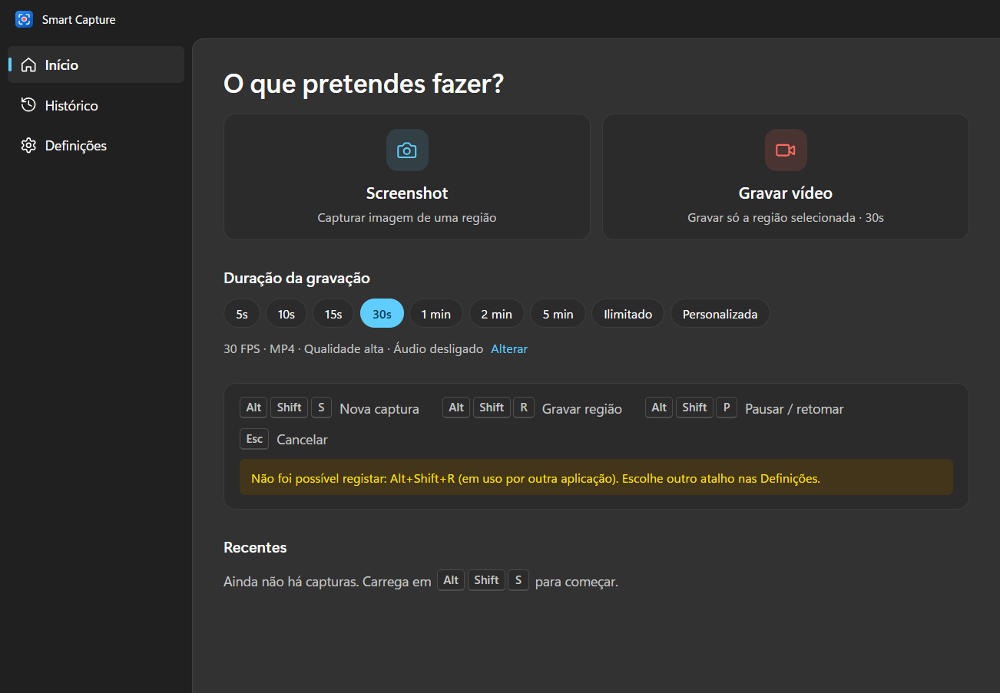
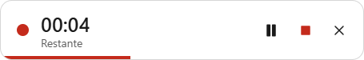
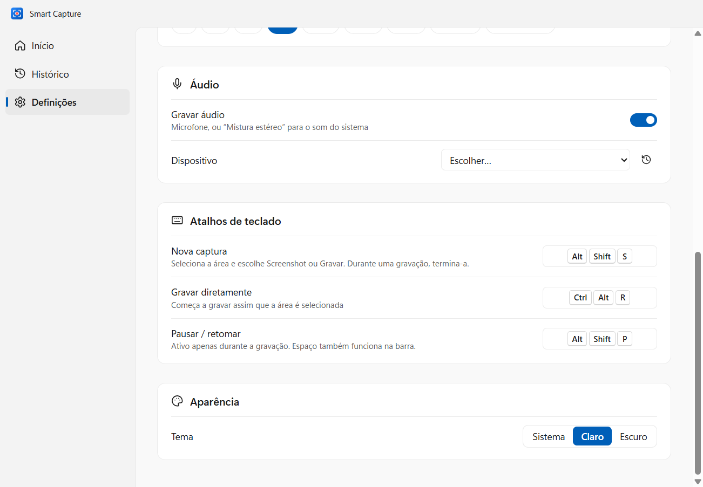

<div align="center">


# Smart Capture

**Seleciona uma área do ecrã. Tira um screenshot ou grava-a em vídeo. Pronto.**

Uma alternativa moderna à Ferramenta de Recorte do Windows, com gravação real de regiões, duração definida e pausa/retoma.

[](https://github.com/bixo16/smart-capture/releases/latest/download/SmartCapture-Setup-1.0.0.exe)


<br>



</div>

---

## ✨ Em três passos

| 1. Atalho | 2. Seleciona | 3. Escolhe |
|:---:|:---:|:---:|
| Prime <kbd>Alt</kbd>+<kbd>Shift</kbd>+<kbd>S</kbd> em qualquer lado | Arrasta, ajusta pelas pegas ou move a área | **Screenshot** ou **Gravar**, com a duração que quiseres |

O ficheiro é guardado automaticamente, o screenshot vai para a área de transferência e tudo aparece no **Histórico**.

## 🎯 Porque é diferente

> **Captura real da região, sem gravar o ecrã inteiro e recortar depois.**

Cada frame é lido do Windows **apenas no retângulo que selecionaste**, em píxeis físicos e na resolução original. Funciona com escalas de ecrã de 125% e 150%, e cada monitor tem a sua própria camada de seleção.

## 🚀 Funcionalidades

<table>
<tr>
<td width="50%" valign="top">

### 📸 Screenshot
- PNG ou JPG
- Copiado para a área de transferência
- Guardado na pasta que escolheres
- Notificação com acesso rápido

### 🎬 Gravação de vídeo
- MP4 (H.264) ou WebM (VP9)
- 30 ou 60 FPS e três níveis de qualidade
- Áudio do microfone ou do sistema (opcional)
- Pausar, retomar, terminar ou descartar

</td>
<td width="50%" valign="top">

### ⏱️ Duração à tua medida
- 5s · 10s · 15s · 30s · 1 min · 2 min · 5 min
- Personalizada (minutos e segundos)
- Ilimitada: paras quando quiseres
- Contagem decrescente; para e guarda sozinha

### 🗂️ Histórico
- Pré-visualiza imagens e reproduz vídeos
- Abrir, copiar, guardar como, abrir a localização
- Eliminar (vai para a Reciclagem)
- Filtrar e ordenar por data

</td>
</tr>
</table>

<div align="center">
<br>
<sub>A barra flutuante de gravação fica sempre de fora do vídeo.</sub>
</div>

## ⌨️ Atalhos

| Ação | Atalho predefinido |
|---|---|
| Nova captura (durante uma gravação, termina-a) | <kbd>Alt</kbd>+<kbd>Shift</kbd>+<kbd>S</kbd> |
| Gravar diretamente | <kbd>Ctrl</kbd>+<kbd>Alt</kbd>+<kbd>R</kbd> |
| Pausar / retomar | <kbd>Alt</kbd>+<kbd>Shift</kbd>+<kbd>P</kbd> ou <kbd>Espaço</kbd> na barra |
| Cancelar | <kbd>Esc</kbd> |

Todos os atalhos podem ser personalizados. O <kbd>Win</kbd>+<kbd>Shift</kbd>+<kbd>S</kbd> está reservado pelo Windows para a Ferramenta de Recorte.

## 🎨 Claro, escuro ou automático

<div align="center">

</div>

O design segue o Windows 11: cantos arredondados, animações suaves e tema que acompanha o sistema.

## 📥 Instalação

1. Descarrega o **[SmartCapture-Setup-1.0.0.exe](https://github.com/bixo16/smart-capture/releases/latest/download/SmartCapture-Setup-1.0.0.exe)**.
2. Abre o instalador. Se o SmartScreen avisar, clica em **Mais informações → Executar mesmo assim** (o instalador ainda não está assinado digitalmente).
3. A app fica na área de notificação, ao lado do relógio. Fechar a janela não a encerra, e os atalhos continuam a funcionar.

## 🛠️ Como funciona

```
Atalho global ─▶ camada de seleção (uma por monitor, com o DPI de cada um)
              ─▶ retângulo em DIP ─▶ screen.dipToScreenRect ─▶ píxeis físicos
              ─▶ ffmpeg gdigrab -offset_x -offset_y -video_size  (BitBlt só da região)
              ─▶ H.264 / VP9  ─▶  ficheiro + Histórico
```

- **Pausa e retoma:** cada pausa fecha um segmento. No fim, os segmentos são juntos com o `concat` do FFmpeg, **sem recodificar**, por isso não há perda de qualidade.
- **Duração exata:** cada segmento recebe `-t <tempo restante>`. Uma gravação de 5 s a 30 FPS tem exatamente 150 frames.
- **Segurança:** o renderer corre em sandbox com `contextIsolation`, e só os ficheiros do histórico são servidos à interface.

## 👩‍💻 Desenvolvimento

```bash
npm install
npm run dev        # hot reload
npm test           # testes dos argumentos do FFmpeg
npm run typecheck
npm run dist       # gera o instalador em dist/
```

```
src/main/      atalhos, tray, camadas de seleção, captura e gravação, definições e histórico
src/preload/   ponte IPC segura
src/renderer/  UI React: janela principal, seleção e barra de gravação
src/shared/    tipos partilhados
```

**Stack:** Electron · React · TypeScript · electron-vite · FFmpeg (`ffmpeg-static`) · electron-builder

<div align="center">
<sub>Feito para o Windows 10 e 11 💙</sub>
</div>
